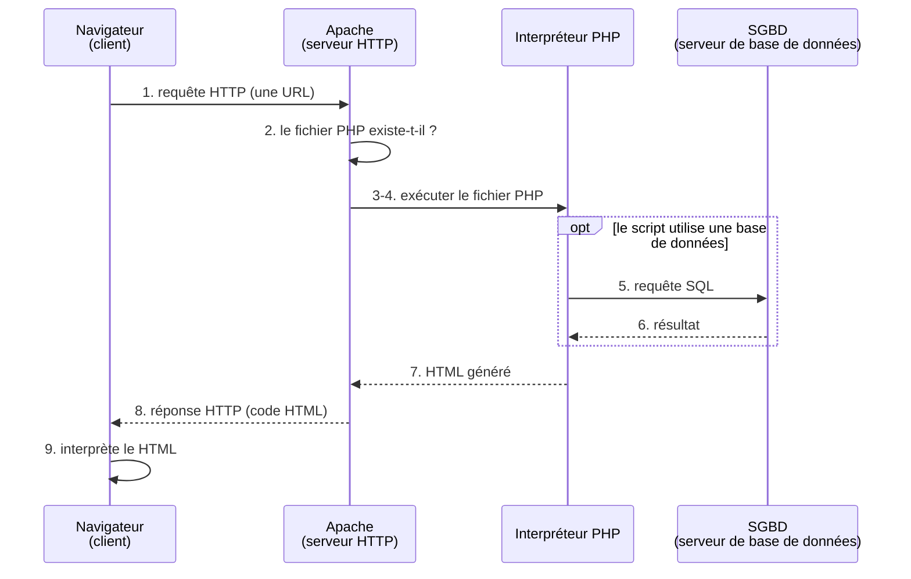

# Le client et le serveur : ce que le navigateur reçoit

À la fin de ce TP, vous saurez :

- décrire le rôle du client et du serveur quand on demande une page PHP ;
- distinguer le code PHP, exécuté sur le serveur, du HTML, interprété par le navigateur ;
- afficher plusieurs lignes dans une page avec les balises HTML `<br>` et `<pre>` ;
- lire dans le navigateur la méthode et le code de statut HTTP d'une requête.

Prérequis : le TP 01 (un serveur installé et démarré) et un dossier `tp02` créé dans la racine du serveur, à côté du dossier `tp01`.

## Le client et le serveur

La connexion et l'échange de données entre un navigateur web et un serveur web reposent sur l'architecture **client/serveur** :

- le **client** est le navigateur web. Il envoie une **requête** à un serveur ;
- le **serveur** est un programme (Apache, Nginx, IIS, Tomcat…) qui fonctionne sur une machine. Il reçoit les requêtes et y répond par une **réponse** ;
- le protocole **HTTP** (*HyperText Transfer Protocol*) décrit comment le client et le serveur s'échangent ces messages.

Ce principe n'est pas propre au web : vous le retrouverez avec les bases de données. Un serveur de base de données reçoit des requêtes écrites en langage SQL, envoyées par ses clients, et leur répond. Dans le cheminement ci-dessous, à l'étape 5, c'est l'interpréteur PHP qui devient le client du serveur de base de données.

Le **HTML** (*HyperText Markup Language*) est un langage qui décrit une page web. Une page HTML enregistrée sur le serveur est **statique** : le serveur l'envoie telle quelle, à chaque demande. Prenons un site marchand : un utilisateur doit pouvoir choisir un produit, le mettre dans son panier, puis afficher son panier pour voir la somme de ses achats. Le résultat est **dynamique** : le serveur doit fabriquer les pages à la volée. C'est là que PHP intervient.

PHP signifie *Hypertext Preprocessor*. C'est un langage dédié à la création de pages dynamiques. Un script PHP est exécuté du côté du serveur, par l'interpréteur PHP. Le navigateur n'exécute jamais de PHP : le serveur lui envoie seulement le résultat du script.

## Que se passe-t-il quand on demande une page PHP ?

Vous avez parcouru ce cheminement au TP 01, en ouvrant `http://localhost/tp01/premier.php`. Voici le cheminement d'une demande, du navigateur jusqu'à l'affichage de la page :

1. Le navigateur web émet une requête à partir d'une URL. Cette URL contient le nom du serveur et de la ressource demandée (un fichier PHP).
2. Le serveur HTTP reçoit la requête et vérifie si la ressource (le fichier PHP) existe.
3. Le serveur HTTP accède au fichier PHP.
4. Le contenu du fichier PHP est transmis à l'interpréteur PHP pour être exécuté.
5. Si le script utilise une base de données, l'interpréteur PHP ouvre une connexion avec le serveur de base de données et lui transmet une requête SQL.
6. Le SGBD (système de gestion de base de données) traite la requête SQL et transmet le résultat.
7. Une fois le script PHP exécuté, le code HTML généré est transmis au serveur HTTP, qui l'encapsule pour qu'il soit transportable.
8. La réponse HTTP, qui contient le code HTML, passe du réseau au navigateur.
9. Le navigateur réceptionne le code généré et interprète le code HTML.

Les étapes 5 et 6 n'ont lieu que pour un script qui utilise une base de données : ce cours n'en utilise pas encore. Le schéma suivant reprend les neuf étapes ; le cadre « opt » regroupe les étapes 5 et 6, facultatives.



## Ce que le serveur envoie vraiment

Le navigateur affiche une page, mais qu'a-t-il reçu exactement ? Dans le dossier `tp02` de la racine du serveur, créez un fichier `bonjour.php` :

```php
<?php
echo "Bonjour";
?>
```

**Prédisez** ce que le navigateur va afficher, puis ouvrez `http://localhost/tp02/bonjour.php`. Pour voir ce que le serveur a réellement envoyé, affichez ensuite le code source de la page avec les touches Ctrl+U.

Vous devez voir, dans la page comme dans le code source :

```text
Bonjour
```

Le navigateur n'a reçu que le résultat. Il ne contient aucune trace de `echo` ni de `<?php` : le code PHP est resté sur le serveur, aux étapes 3 et 4 du cheminement.

**Modifiez une seule chose.** Ligne 2, entourez le mot de `<b>` et `</b>` : `echo "<b>Bonjour</b>";`. Ce changement ajoute des signes dans le texte à afficher : pour PHP, ce sont des caractères comme les autres.

```php
<?php
echo "<b>Bonjour</b>";
?>
```

**Prédisez** : la page va-t-elle afficher les signes `<b>` ? Le code source en contiendra-t-il ? Enregistrez, rechargez la page avec F5, puis affichez le code source avec Ctrl+U.

La page affiche le mot `Bonjour` en gras, sans les signes `<b>`. Vous devez voir, dans le code source :

```text
<b>Bonjour</b>
```

PHP n'a rien fait de `<b>` : pour lui, c'est un texte comme un autre, qu'il a envoyé tel quel. C'est le navigateur qui a reconnu la balise `<b>` et qui a écrit le mot en gras.

## HTML et PHP : qui fait quoi ?

Les signes `<b>` et `</b>` ne sont pas du PHP : ce sont des **balises HTML**. Le HTML n'est pas un langage de programmation : il ne calcule rien et ne décide de rien. C'est du texte, qui décrit comment la page est construite, et que le navigateur sait interpréter. Le PHP, lui, est un langage de programmation : il est exécuté sur le serveur, et le navigateur ne le reçoit jamais.

| | HTML | PHP |
| --- | --- | --- |
| Nature | du texte qui décrit la page | un langage de programmation |
| Exemple | `<b>Bonjour</b>` | `echo 2 + 3;` |
| Qui le lit ? | le navigateur (le client) | l'interpréteur PHP (le serveur) |
| Quand ? | après la réception de la page | sur le serveur, avant l'envoi de la page |
| Ce que reçoit le navigateur | le texte, tel quel | rien : seulement le résultat |

On peut donc écrire un fichier qui contient les deux. Dans `tp02`, créez un fichier `page.php` :

```php
<html>
<body>
<p>2 + 3 = <?php echo 2 + 3; ?></p>
</body>
</html>
```

- Les lignes 1, 2, 4 et 5 sont du HTML, en dehors des balises PHP : le serveur les envoie telles quelles.
- La ligne 3 contient du HTML (`<p>` et `</p>`) et du PHP entre `<?php` et `?>` : le serveur remplace le PHP par son résultat.

**Prédisez** ce que le navigateur va afficher et ce que le code source va contenir, puis ouvrez `http://localhost/tp02/page.php` et affichez le code source avec Ctrl+U.

La page affiche :

```text
2 + 3 = 5
```

Vous devez voir, dans le code source :

```text
<html>
<body>
<p>2 + 3 = 5</p>
</body>
</html>
```

Le calcul `2 + 3` a été fait par PHP sur le serveur, avant l'envoi. Les balises HTML sont arrivées intactes : le navigateur ne les affiche pas, il les interprète pour construire la page.

## Passer à la ligne dans une page

Dans le TP 01, `echo` n'ajoutait ni espace ni retour à la ligne. Pour passer à la ligne, PHP sait écrire `\n` dans un texte entre guillemets doubles. Dans `tp02`, créez un fichier `lignes.php` :

```php
<?php
echo "Ligne 1\nLigne 2";
?>
```

**Prédisez** : la page va-t-elle afficher deux lignes ? Ouvrez `http://localhost/tp02/lignes.php`, puis affichez le code source avec Ctrl+U.

La page affiche, sur une seule ligne :

```text
Ligne 1 Ligne 2
```

Vous devez voir, dans le code source :

```text
Ligne 1
Ligne 2
```

PHP a bien envoyé un retour à la ligne : il est dans le code source. Mais le navigateur, quand il interprète du HTML, remplace chaque retour à la ligne du texte par un simple espace. Pour obtenir un saut de ligne dans la page, il faut le demander en HTML, et non en PHP.

**Modifiez une seule chose.** Ligne 2, remplacez `\n` par `<br>` : `echo "Ligne 1<br>Ligne 2";`. La balise HTML `<br>` (*break*, « coupure ») demande au navigateur de passer à la ligne.

```php
<?php
echo "Ligne 1<br>Ligne 2";
?>
```

**Prédisez**, enregistrez, puis rechargez la page.

Vous devez voir, dans la page :

```text
Ligne 1
Ligne 2
```

Il existe une autre solution, qui laisse les `\n` de PHP : demander au navigateur de respecter les retours à la ligne du texte. La balise HTML `<pre>` (*preformatted*, « préformaté ») le fait. Elle se place avant le code PHP, donc en dehors des balises PHP : c'est du HTML, envoyé tel quel.

**Modifiez le fichier `lignes.php`** : remplacez tout son contenu par le script suivant. La ligne 1 est du HTML ; les lignes 2 à 4 sont du PHP, avec `\n` de nouveau.

```php
<pre>
<?php
echo "Ligne 1\nLigne 2";
?>
```

**Prédisez**, enregistrez, puis rechargez la page.

Vous devez voir, dans la page, en police à chasse fixe :

```text
Ligne 1
Ligne 2
```

La balise `<pre>` change aussi la police : les lettres ont toutes la même largeur, comme dans un terminal. Les balises HTML vont souvent par paire : `<pre>` ouvre, `</pre>` ferme. Dans ce cours, nous ne fermons pas `<pre>` en fin de fichier : le navigateur le fait tout seul.

À partir du TP 03, chaque script commence par la ligne HTML `<pre>`, placée avant `<?php` : les résultats s'affichent comme ils sont écrits. Nous utiliserons `<br>` quand la page devra ressembler à une vraie page web.

> [!NOTE]
> Ce qui n'est pas du PHP
>
> `<pre>`, `<br>` et `<b>` sont du HTML. PHP ne les exécute pas : il les envoie au navigateur, qui les interprète. Seul ce qui se trouve entre `<?php` et `?>` est exécuté par PHP, sur le serveur.

## Lire la méthode et le code de statut HTTP

Chaque requête du navigateur a une **méthode** : `GET` signifie « donne-moi cette ressource ». Chaque réponse du serveur contient un **code de statut**, un nombre à trois chiffres qui indique si la requête a réussi. Le navigateur les affiche dans son inspecteur, appelé aussi « devtools » :

1. Ouvrez l'inspecteur avec la touche F12, puis l'onglet « Réseau » (« Network » dans Chrome).
2. Rechargez la page `http://localhost/tp02/bonjour.php` avec la touche F5.
3. Une ligne apparaît dans l'onglet : c'est la requête que le navigateur vient d'envoyer.

Pour de l'aide sur l'inspecteur, consultez la documentation de [Firefox](https://firefox-source-docs.mozilla.org/devtools-user/index.html) ou de [Chrome](https://developer.chrome.com/docs/devtools/open/).

**Prédisez** la méthode et le code de statut de cette requête.

Vous devez voir, dans les colonnes de l'onglet Réseau de Firefox :

```text
État   Méthode   Domaine     Fichier
200    GET       localhost   bonjour.php
```

La méthode est `GET`. Le code `200` signifie que la requête a réussi : le serveur a trouvé le fichier et il a répondu.

## Lire un code d'erreur : 404

**Modifiez une seule chose.** Dans la barre d'adresse, remplacez `bonjour.php` par `inexistant.php`. Ce changement désigne un fichier qui n'existe pas dans le dossier `tp02`.

**Prédisez** le code de statut, puis validez l'adresse.

Le navigateur affiche, avec Apache sous Linux :

```text
Not Found

The requested URL was not found on this server.
```

Vous devez voir, dans l'onglet Réseau :

```text
État   Méthode   Domaine     Fichier
404    GET       localhost   inexistant.php
```

C'est l'erreur que vous avez provoquée au TP 01, vue cette fois dans l'inspecteur. Le code `404` signifie « ressource introuvable » : l'URL désigne un fichier qui n'existe pas à cet endroit de la racine du serveur. Le code `200` signifie au contraire que la ressource a été trouvée.
